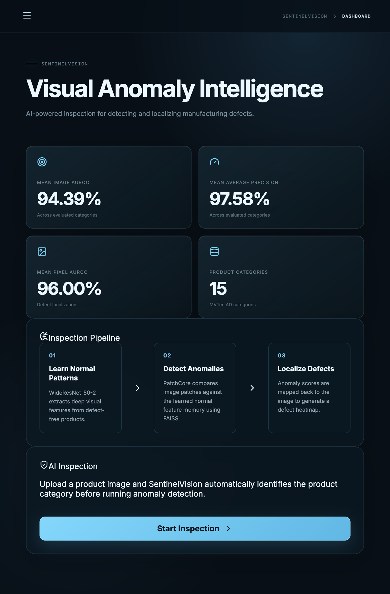
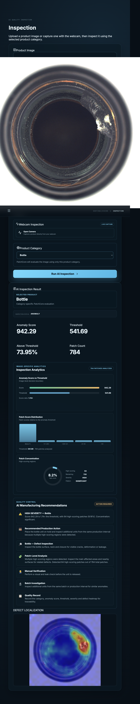

# SentinelVision

<p align="center">
  
</p>

Visual Anomaly Detection & Defect Localization for Smart Manufacturing.

SentinelVision is a full-stack industrial anomaly detection system built around a PatchCore-inspired architecture for MVTec AD imagery. It combines a WideResNet-50-2 embedding backbone, FAISS nearest-neighbor search, and a FastAPI + React workflow to detect defects, score anomalies, and localize faults with defect heatmaps.

## Overview

SentinelVision is designed for visual quality inspection in manufacturing environments, where the goal is to identify subtle product defects while preserving rapid, category-aware evaluation. The project supports real image inspection, category-specific anomaly scoring, and per-category performance metrics for production-style analysis.

## Key Features

- PatchCore-inspired anomaly detection and image-level scoring
- WideResNet-50-2 feature extraction for robust visual representations
- FAISS-based memory-bank matching for anomaly comparison
- Category-specific inference for 15 MVTec AD classes
- Defect heatmap generation for spatial localization
- FastAPI backend for health checks, evaluation, and inspection requests
- React + Vite frontend for dashboard, analytics, and inspection workflows
- Severity and quality-control recommendations based on threshold comparisons

## Screenshots

### Dashboard

<p align="center">
  
</p>

### Inspection Result

<p align="center">
  
</p>

### Evaluation Plot

<p align="center">
  
</p>

## Supported Categories

- bottle
- cable
- capsule
- carpet
- grid
- hazelnut
- leather
- metal_nut
- pill
- screw
- tile
- toothbrush
- transistor
- wood
- zipper

## Architecture

- `api.py` — FastAPI application and inspection endpoints
- `src/` — backbone, PatchCore model, localization, feature extraction, and evaluation logic
- `models/` — category memory banks and classifier artifacts
- `results/` — per-category thresholds, metrics, and generated heatmaps/plots
- `data/` — MVTec AD sample images and evaluation data
- `frontend/` — Vite + React dashboard and inspection UI
- `evaluate.py` and `evaluate_localization.py` — performance evaluation scripts
- `inference.py` — inference utilities and helpers

## Quick Start

### 1) Install dependencies

This project uses Python 3.11 and a local virtual environment at `.venv/`.

```bash
cd ~/Desktop/SentinelVision
source .venv/bin/activate
python -m pip install --upgrade pip
pip install -r requirements.txt
```

### 2) Start the backend

```bash
cd ~/Desktop/SentinelVision
source .venv/bin/activate
uvicorn api:app --host 127.0.0.1 --port 8000
```

### 3) Start the frontend

```bash
cd ~/Desktop/SentinelVision/frontend
npm install
npm run dev -- --host 127.0.0.1
```

Then open:

- `http://127.0.0.1:5173/`

## API Overview

The backend exposes the following routes:

- `GET /api/health` — backend health and environment status
- `GET /api/evaluation` — per-category evaluation metrics
- `POST /api/inspect` — upload an image and inspect it for anomalies

### Example health check

```bash
curl http://127.0.0.1:8000/api/health
```

### Example inspection request

```bash
curl -X POST 'http://127.0.0.1:8000/api/inspect' \
  -F 'category=bottle' \
  -F 'file=@data/bottle/test/broken_small/002.png'
```

## Real Validation Notes

The app was validated locally with:

- successful FastAPI startup via Uvicorn
- live health endpoint response from `/api/health`
- a real anomaly classification on `data/bottle/test/broken_small/002.png`
- successful React build with `npm run build`
- working browser-driven inspection flow displaying a real `ANOMALY` status and heatmap-based defect localization

## Project Results

The evaluation pipeline includes image-level and pixel-level metrics for each supported category, with threshold-based detection logic and defect localization overlays.

<p align="center">
  
</p>

## Troubleshooting

- If a category memory bank is missing, the backend returns a `404` for that category.
- Confirm that `data/` and `models/` contain the expected dataset and model files before running inspection.
- Make sure the frontend uses the correct backend URL: `http://127.0.0.1:8000`.
- If camera access is denied, allow webcam permission or use the file upload workflow instead.

## License and Usage

This project is intended for industrial visual inspection research, prototyping, and local experimentation. It is designed to run on a local machine and evaluate anomaly detection workflows using the MVTec AD dataset and PatchCore-style inference.

